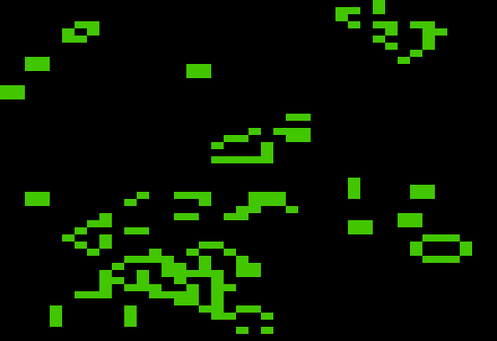
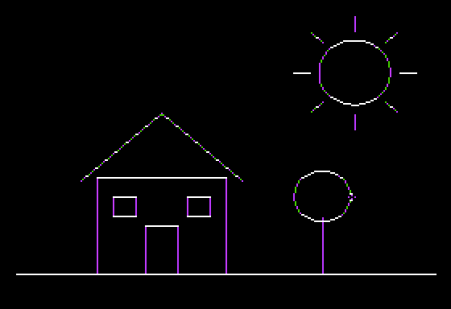
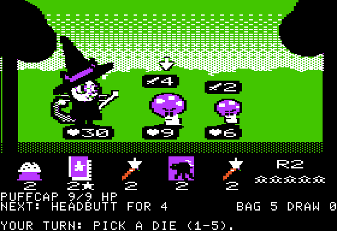

# Tisple ][

A small typed Lisp for the Apple II, with its own optimising 6502 compiler. It comes with a
cycle-exact Apple IIe to run on, disk tools, and a WebAssembly player for phones and
browsers.

<p>




</p>

*Plasma at 25 fps, Conway's Life, a mouse paint program, and Catwiz, on the built-in IIe.*

Try it in a browser: **[web demo](https://wegfawefgawefg.github.io/tisple/)** (Catwiz, plasma,
Life, Snake and an 80-column book, booting from disk images).

```scheme
(import apple2 a2)
(import keys)
(import lores)
(import tables)
(import timing)

; 20 + 19 sin(2 pi i / 256), worked out by the compiler into a 256-byte table
(macro wave (i)
    (round (+ 20 (* 19 (sin (/ (* (* 2 pi) i) 256))))))

(tables.table WAVE u8 256 wave)

; an array of structs is stored as one byte table per field
(struct Dot ((x u8) (phase u8) (color u8)))

(let dots (array Dot 40))

(fn main () void
    (lores.show)
    (lores.clear)
    (for i u8 0 40
        (set (at dots i) (make Dot :x i :phase (* i 6) :color (+ (& i 7) 8))))
    (while (!= (keys.read) a2.KEY_ESC)
        (timing.frame)
        (for i u8 0 40
            (let d Dot (at dots i))
            (lores.plot d.x (at WAVE d.phase) lores.BLACK)
            (set (at dots i phase) (+ d.phase 3))
            (lores.plot d.x (at WAVE (+ d.phase 3)) d.color))))
```

`tisple build --asm` prints each line's code with its cycles. The `set` line, labels
trimmed, with `d` in zero page and `i` loaded into X:

```text
LDA $0C       ; d.phase     (3)
CLC           ;             (2)
ADC #$03      ;             (2)
LDX $0A       ; i           (3)
STA $616B,X   ; dots.phase  (5)
```

## Speed

13 kernels written in C for cc65, LLVM-MOS and Oscar64, and in Tisple, all timed on the same
cycle-exact simulator, each output checked. Tisple is fastest on all 13. Cycles, lower is better. These are from
`races/run.sh` on this commit (2026-10-30); settings, versions and per-kernel notes in
[`docs/races.md`](docs/races.md).

| Kernel | cc65 | LLVM-MOS | Oscar64 | Tisple | vs best other |
| --- | ---: | ---: | ---: | ---: | ---: |
| 8-bit multiply | 80,903 | 101,512 | 63,165 | **29,331** | 0.46 |
| 16-bit multiply | 101,818 | 90,156 | 65,477 | **31,296** | 0.48 |
| Mandelbrot | 11,216,044 | 9,969,128 | 7,601,337 | **4,177,022** | 0.55 |
| memcpy 4 KB | 59,878 | 153,449 | 65,824 | **38,151** | 0.64 |
| fill 8 KB | 63,996 | 238,896 | 90,467 | **43,022** | 0.67 |
| Life step | 1,333,565 | 232,244 | 238,566 | **161,089** | 0.69 |
| insertion sort | 2,020,054 | 463,713 | 422,725 | **356,260** | 0.84 |
| CRC-16 | 650,111 | 257,916 | 221,527 | **188,348** | 0.85 |
| sieve | 2,285,731 | 2,510,574 | 1,258,060 | **1,086,425** | 0.86 |
| sprites | 819,546 | 117,496 | 76,125 | **65,957** | 0.87 |
| strlen | 36,153 | 186,081 | 39,103 | **31,642** | 0.88 |
| hi-res lines | 2,451,456 | 767,813 | 576,133 | **506,033** | 0.88 |
| search | 536,420 | 136,618 | 150,500 | **128,734** | 0.94 |

cc65 V2.19, llvm-mos-sdk v23.4.0, Oscar64 v1.32.273, each at its fastest setting, plain
NMOS 6502. Fill and memcpy use Tisple's `unroll` macro.

On 2000 random programs from the fuzz generator, each also written in C and raced the same
way (`races/random.sh`), Tisple's cycles are a geometric mean of 0.809 of the fastest other
compiler's, and it is the fastest on 69.1% of them (2026-10-30, `docs/dogfood.md`).

Kernels and generated programs flatter it. On ten program-shaped benchmarks (100-450 lines
each, written plainly in both languages: BYTE sieve, Dhrystone, a sort, a text-adventure
parser, LZ4, a bytecode VM, BFS on a grid, a sprite blitter, a tile scroller, decimal
scores; `races/run.sh --programs`) it is about even with the best C compiler, Oscar64:

| Program | cc65 | LLVM-MOS | Oscar64 | Tisple | vs best other |
| --- | ---: | ---: | ---: | ---: | ---: |
| decimal scores | 10,148,189 | 6,656,057 | 3,365,122 | **1,699,799** | 0.51 |
| bytecode VM | 12,676,676 | 7,360,089 | 5,628,776 | **4,471,198** | 0.79 |
| parser | 8,244,051 | 1,782,671 | 2,280,481 | **1,436,999** | 0.81 |
| BYTE sieve | 20,598,829 | 22,068,852 | 14,349,970 | **12,090,810** | 0.84 |
| sprite blitter | 6,688,330 | 4,499,903 | **2,186,965** | 2,365,823 | 1.08 |
| LZ4 | 3,199,397 | 1,212,242 | **901,828** | 1,183,148 | 1.31 |
| tile scroller | 45,569,306 | 12,854,461 | **8,869,763** | 12,642,268 | 1.43 |
| BFS | 10,098,451 | 5,643,078 | **3,157,011** | 4,818,412 | 1.53 |
| Dhrystone | 2,205,531 | 951,470 | **391,865** | 858,590 | 2.19 |
| sort | 3,820,411 | 2,192,144 | **1,202,552** | miscompiled | - |

Geometric mean over the nine it runs: 1.07 of the fastest other. The losses are mostly the
inliner's limits, induction variables kept after pointers replace them, and struct copies
through zero page; the sort is a Tisple miscompile being fixed. Details and the reduced
bugs (ours and Oscar64's) in [`docs/races.md`](docs/races.md).

How: whole-program compilation; no recursion, so every function has a static frame,
frames of functions that never run together share bytes, and they live in zero page where
they fit; struct and 16-bit arrays split into byte tables (`LDA field,X`); pointers stepped
in `(p),Y`; known carry and value ranges; division by constants unrolled; quarter-square
multiply tables; and a profiler and superoptimizer that rank every wasted cycle
(`tisple gaps`).

## Quickstart

Needs C++20 (clang), CMake and Ninja; SDL3 for the window (optional).

```sh
cmake --preset release && cmake --build --preset release    # build/tisple
build/tisple run programs/plasma/main.tsp                   # compile and open the window
build/tisple run programs/life/main.tsp --frames 300 --screenshot life.png   # headless
build/tisple build programs/snake/main.tsp --disk snake.dsk # a disk that boots itself
build/tisple machine --disk snake.dsk --window              # boot it on the built-in IIe
```

`tisple new hello` makes a folder with a starter project (`tisple init` makes one in the
current folder). In a folder with a `tisple.project` (docs/language.md), a bare `tisple build`
or `tisple run` builds or plays that project.

`tisple help` lists the commands. Tests: `cmake --preset dev && cmake --build --preset dev
&& ./build-debug/tisple_tests`.

## What it leaves out

On purpose, because each costs cycles or bytes on a 1 MHz 6502 or tells the compiler less:
no recursion (the checker rejects call-graph cycles), no heap, no closures, no floats at
run time, no integers wider than 16 bits, no implicit widening (`(+ (as u16 a) b)`), no
type inference beyond literals, no inline assembler (`jsr` calls existing code with A, X
and Y set), no separate compilation. Macro code runs in the compiler and has floats, lists,
recursion and closures, so tables, sprites from ASCII art and unrolled loops are built
there. Only the NMOS 6502 is targeted so far. Details in
[`docs/language.md`](docs/language.md).

## What's in the box

- **The language.** `u8`/`i8`/`u16`/`i16`, `bool`, structs, enums with `match`, modules,
  pointers, function pointers, interrupt handlers, placement (`:boundary 256`, `:in aux`),
  and compile-time macros. [`docs/language.md`](docs/language.md).
- **A built-in Apple IIe.** Cycle-exact 6502 (floooh's chips), text in 40 and 80 columns,
  lo-res and hi-res with NTSC colour, speaker, keyboard, 128K with the language card,
  AppleMouse, Disk II, Mockingboard, snapshots. It runs on its own boot ROM, mouse firmware
  and font, so nothing of Apple's is needed or shipped; it boots Apple's ROMs if you have
  them.
- **`tisple run`** compiles (milliseconds for these programs) and opens the window;
  headless with `--frames`, `--keys`, `--mouse`, `--screenshot`, `--wav`.
- **Self-booting disks.** `tisple build --disk` writes a `.dsk` with our own loader and no
  DOS, which loads the program into main memory, the language card and aux memory;
  `tisple disk` edits DOS 3.3 images. They boot in the emulator with our ROM and with
  Apple's; not yet tried on a real machine ([`docs/disks.md`](docs/disks.md)).
- **Phone and web player.** The machine as WebAssembly, with on-screen buttons per game
  ([`docs/phone.md`](docs/phone.md)); `web/pages.py` builds the web demo.
- **Editor support.** VS Code: colours, hover types, go to definition, find references,
  outline, errors as you type, format on save, F5 to run. Neovim syntax too
  ([`editors/`](editors/README.md)).
- **Correctness.** A reference interpreter, and tens of millions of random programs
  compiled and compared with it byte for byte (`scripts/fuzz_farm.sh`).

## Programs

| Program | Run |
| --- | --- |
| Plasma | `tisple run programs/plasma/main.tsp` |
| Life | `tisple run programs/life/main.tsp` |
| Snake | `tisple run programs/snake/main.tsp` |
| Paint (mouse) | `tisple run programs/paint/main.tsp` |
| Text viewer (80 columns, 72 KB) | `tisple run programs/text_demo/main.tsp` |
| Mockingboard music and effects | `tisple run examples/mockingboard_demo.tsp --mockingboard 4 --rom Apple2e.rom` (its interrupts go through Apple's ROM: your own copy) |

Libraries are in `lib/`: the hardware by its Apple names (`apple2`), 40- and 80-column
text, lo-res and hi-res, aux memory, keyboard, mouse, speaker, frame timing, Mockingboard
music ([`docs/mockingboard.md`](docs/mockingboard.md)), random numbers, and table and
unrolling macros. `(import name)` finds them after the program's own folder.

## Catwiz

[Catwiz](https://github.com/wegfawefgawefg/catwiz) is a dice roguelike for the 128K
Apple IIe written in Tisple: hi-res art, Mockingboard music, about 18 KB of code across
main memory and the language card. Two fights and a reward play; it is shelved
unfinished. It was the program that pushed the compiler hardest; [`docs/dogfood.md`](docs/dogfood.md)
logs what it needed. Playable in the [web demo](https://wegfawefgawefg.github.io/tisple/).

## Docs

In [`docs/`](docs/): [`design.md`](docs/design.md) why the language looks like this and
how the backend works, [`language.md`](docs/language.md) the language,
[`disks.md`](docs/disks.md) disks and the boot ROM, [`phone.md`](docs/phone.md) the web
player, [`mockingboard.md`](docs/mockingboard.md) sound, [`races.md`](docs/races.md) the
compiler races, [`benchmarks.md`](docs/benchmarks.md) speed history,
[`roadmap.md`](docs/roadmap.md) the plan, [`dogfood.md`](docs/dogfood.md) the working log.

## License

GPL-3.0-or-later (`LICENSE`), with a runtime exception: the startup and runtime code the
compiler puts into your programs, and the disk loader, are also MIT, so programs built
with Tisple can use any license. See `COPYRIGHT`. Code under `third_party/` keeps its own
license.
