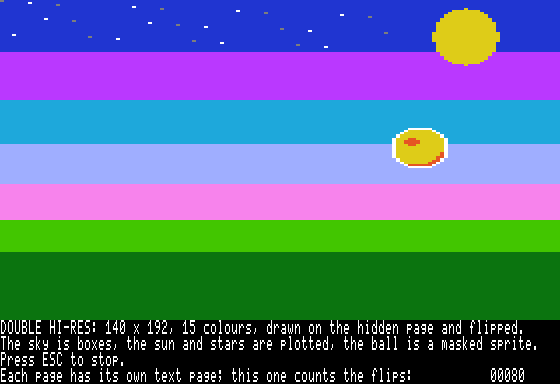
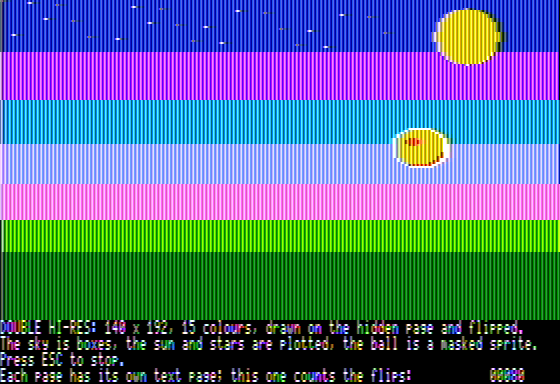

# Double hi-res and packed data

Double hi-res graphics (`lib/dhgr`) and tables packed while compiling (`tables.packed`, `(pack
bytes)`, `lib/unpack`). Added 2026-10-30 for Catwiz's move to double hi-res, with art in three
looks and loaded a fight at a time.

## Run it

```sh
tisple run examples/dhgr_demo.tsp                  # a ball bounced with page flipping
tisple run examples/dhgr_demo.tsp --frames 200 --screenshot demo.png
tisple run examples/dhgr_demo.tsp --frames 200 --ntsc --screenshot demo_ntsc.png
tisple run examples/dhgr_packed.tsp                # a picture packed while compiling
```

<p>



</p>

## The screen

- A line is 560 dots. Byte column c (0-39) shows its aux memory byte's 7 dots, then its main
  memory byte's 7, bit 0 first; bit 7 is not shown.
- Colour comes from 4-dot groups counted from the line's start: the group's dots as a nibble
  (bit i is dot 4g + i) are the lo-res colour number. So the screen is 140 x 192 pixels in 16
  colours, 15 different (5 and 10 are the same grey). 7 pixels take 4 bytes: aux, main, aux,
  main, and a colour's bytes repeat every 2 columns of each memory.
- A page is 8 KB of main memory and 8 KB of aux memory at the same addresses: page 1 at
  `$2000`, page 2 at `$4000`.
- On: 80VID on (`SET80VID`), graphics (`TXTCLR`), `HIRES`, AN3 off (`AN3OFF`), and `MIXSET`
  for 4 lines of 80-column text under 160 lines of picture, `MIXCLR` for all 192.
- The page shown is `LOWSCR` or `HISCR`, with 80STORE off. With 80STORE on, PAGE2 picks the
  memory `$2000`-`$3FFF` writes go to instead, and page 1 is always shown; that is why
  lib/dhgr never turns 80STORE on.
- The mixed window's text is text page 1 with page 1 and text page 2 (`$0800`) with page 2, so
  a program that flips pages writes its text to both.

## lib/dhgr

```scheme
(import dhgr)

(dhgr.clear dhgr.PAGE1 dhgr.DARK_BLUE)
(dhgr.box dhgr.PAGE1 10 40 6 20 dhgr.ORANGE)      ; byte columns 10-15, rows 40-59
(dhgr.plot dhgr.PAGE1 70 100 dhgr.WHITE)          ; pixel x 0-139
(dhgr.masked dhgr.PAGE1 dhgr.AUX col top 4 22 (addr_of (at ball_aux 0)) (addr_of (at ball_aux 88)))
(dhgr.masked dhgr.PAGE1 dhgr.MAIN col top 4 22 (addr_of (at ball_main 0)) (addr_of (at ball_main 88)))
(dhgr.on true)                                    ; true: the mixed text window
(dhgr.flip)                                       ; and draw on (dhgr.hidden)
```

| Call | Does | Cycles |
| --- | --- | ---: |
| `(dhgr.on mixed)`, `(dhgr.off)` | the mode on and off; off is 40-column text | |
| `(dhgr.show page)`, `(dhgr.flip)`, `dhgr.shown`, `(dhgr.hidden)` | the page shown | |
| `(dhgr.clear page colour)` | the whole page | 217,000 |
| `(dhgr.box page col top w h colour)` | a box of byte columns, both memories | 25 a column, 120 a row |
| `(dhgr.fill page bank col top w h even odd)` | one memory's bytes of a box, `even` in even columns | 13 a byte, 60 a row |
| `(dhgr.copy page bank col top w h pic)` | `w` bytes a row from `pic` | 16 a byte, 80 a row |
| `(dhgr.masked page bank col top w h pic mask)` | each byte `(screen & mask) \| pic` | 26 a byte, 95 a row |
| `(dhgr.copy_box page bank col top w h from)` | the same box of another screen-shaped page (`from`, a high byte in `$20` steps) | 16 a byte, 70 a row |
| `(dhgr.plot page x y colour)` | one pixel | 270 |
| `(dhgr.aux_rmw addr keep set)` | an aux byte becomes `(byte & keep) \| set`; gives what it was | 110 |
| `(dhgr.text_row page row codes)` | 80 screen codes onto a text row of the page's text page | 2,500 |
| `(dhgr.runs page bank col top h runs flags)` | a sprite half stored as runs (below), from its memory or the aux language card | 16 a byte opaque, 26 masked, about 40 a run |

Cycles from `tisple run --sim`, each call about 200 more (2026-10-30). A 4-byte, 22-row
sprite masked in both memories is about 9,000 cycles.

- Pages are `dhgr.PAGE1` and `dhgr.PAGE2` (`$20`, `$40`: their high bytes); banks
  `dhgr.MAIN` and `dhgr.AUX`; colours `dhgr.BLACK` to `dhgr.WHITE` in lo-res order.
  `dhgr.ROW` is row y's address on page 1 (add `$2000` for page 2).
- Boxes and sprites go on byte columns, one memory at a time. For `dhgr.AUX` the picture,
  mask and `from` page are in aux memory (lets `:in aux`), for `dhgr.MAIN` in main memory.
  Sprite bytes made for an even column draw right at every even column. Nothing is clipped;
  `w` is 1-40.
- Reserved in both memories: both pages (`$2000`-`$5FFF`) and `$1E00`-`$1FF0` for the code
  below: about 33 KB of the 128; in main memory `$1D8A`-`$1DDC` for lib/auxcard. Text page 2
  (`$0800`-`$0BFF`, both memories) only with `(import dhgr_text2)`, for a program that shows
  the mixed window's text with page 2 (examples/dhgr_demo); a full-screen one has that 2 KB
  (2026-10-30).
- Aux memory is written with RAMWRT and read with RAMRD. With RAMRD on the 6502 fetches its
  instructions from aux memory too, so everything that runs with a switch on is our own 6502
  code, 497 bytes at `$1E00` in both memories: copied there the first time (main memory's copy
  from a const, aux memory's with `auxmem.write`). The box routines take their arguments in
  auxmem's zero page (`$F2`-`$FE`) and X (the memory); a row's address is worked out once and
  then moved `$400` a row inside each 8-row band. `plot` is Tisple: tables say which byte or
  two each of a group's 7 pixels falls in, and the colour's bits there.
- An interrupt handler needs `(auxmem.guard)` first, as for lib/auxmem.

### Runs, and the aux language card

Added 2026-10-30 for Catwiz, whose sprites do not fit as whole boxes of picture and mask.

- A sprite half (one memory's bytes) as runs: per row, control bytes up to a 0. 1-63 skips
  that many bytes; `$40 + n` is followed by n picture bytes, copied (opaque); `$80 + n` by n
  picture bytes and then their n masks, each screen byte `(screen & mask) | picture`. n is
  1-63. A row stores only its bytes with something in them, and masks only at the edges.
  Rows are drawn top to bottom from `col` (even, as for `masked`); the runs end themselves.
- `dhgr.AS_WHITE` draws the shape in white: opaque bytes `$7F`, edged ones
  `screen | (mask ^ $7F)` (a hit flash).
- `dhgr.FROM_CARD` (bank 2, `$D000`-`$FFFF`) or `dhgr.FROM_CARD1` (bank 1's `$D000`-`$DFFF`):
  the runs are in the aux language card, the extended 80-column card's own
  16 KB at `$D000`-`$FFFF`, which nothing but code running with ALTZP on reaches. lib/auxcard
  runs our code that way: it puts the card's bank asked for in, copies auxmem's zero page
  arguments to aux memory's zero page, turns interrupts off and ALTZP on; afterwards puts back
  the card's bank (or the rom) and the interrupt flag. Between rows `runs` turns ALTZP off and
  lets interrupts in for a moment (`CLI`, `NOP`, `SEI`), so a tick is late by at most a row's
  drawing. `unpack.aux_to_card` and `unpack.main_to_card` (with the bank, `auxcard.BANK2` or `BANK1`) put bytes there (with interrupts off
  throughout: ticks that come meanwhile are lost but one).
- lib/dhgr_pixels: `(dhgr_pixels.row page col top groups pixels)` writes a row of colour pixels
  (a byte each in main memory) as whole bytes in both memories, about 210 cycles a group: for
  a hud drawn in whole pixels (Catwiz's text in colour pixels, its badges and cards). Its code
  sits where the layout puts it (RAMRD stays off) and finds its tables the first time.
- So a game can keep the main memory halves of its sprites in the aux card (12 KB at `$D000`
  in bank 2, 4 KB more in bank 1) and the aux halves there or in aux memory, and main memory
  has none of them. tests/test_dhgr_runs.cpp: made-up halves drawn from each
  place, plain and white, under the Mockingboard's ticks with the guard, no tick lost, the card
  and the rom put back.
- examples/dhgr_demo draws a frame on the hidden page and flips at the next vertical blank:
  the ball's old box redrawn as sky (boxes), three stars plotted, the ball masked in both
  memories, the flip count in 80-column text on the page's own text page. That takes a little
  more than one frame, so it flips 30 times a second.

## Packed data

```scheme
(import tables)
(import unpack)

(tables.packed_bytes backdrop_aux (0 0 85 42 ...) :in aux)   ; a let in aux memory
(tables.packed_bytes BACKDROP_MAIN (0 0 85 42 ...))          ; a const in main memory
(tables.packed WAVES 4096 wave)                              ; (wave 0) ... (wave 4095)

(unpack.aux_to_aux (as (ptr u8) 0x2000) (addr_of (at backdrop_aux 0)))
(unpack.main_to_main (as (ptr u8) 0x2000) (addr_of (at BACKDROP_MAIN 0)))
```

- `(tables.packed NAME count f options ...)` and `(tables.packed_bytes NAME (bytes ...)
  options ...)` pack the bytes while compiling into `(array u8 n)`, n the packed count. With
  `:in aux` it is a let in aux memory (so the name is snake_case), otherwise a const.
- `(pack bytes)` in macro code is the packer itself: a list of 1 to 65535 bytes in, the packed
  list out.
- `unpack.main_to_main`, `aux_to_aux`, `aux_to_main` and `main_to_aux` take `dst` and `src`
  pointers (`src` where the packed bytes are, in the memory the name says first). The packed
  bytes end themselves; `dst` needs room for all of them. RAMWRT stays on the output's memory,
  RAMRD on the packed bytes' and on the output's while a match is copied, so packed bytes in
  aux memory can come out in main and the other way.
- The unpacker is our own 394 bytes at `$1C00` in both memories (`$1C00`-`$1D89` reserved),
  copied there the first time, aux memory's copy only once a mode needs it. It borrows
  auxmem's zero page. 26 to 49 cycles a byte out (below): long runs are fast, short matches
  and literals slow. With an interrupt handler, `(auxmem.guard)` first.

### The format, by measurement

The format is ZX0 (Einar Saukas's, version 2: forward, the offset's high part inverted), so the
reference `zx0` and `dzx0` tools read and write the same bytes. Measured on Catwiz's double
hi-res art as tools/dhgr exports it (art/dhgr: 6 screens, packed a memory's half at a time;
15 lit sprite frames, 15 materials, 3 patches, the icons and both fonts), the double hi-res
mockup for Catwiz (16 screen halves of the round-2 art directions and 4 of the first viewer,
and 12 sprite sheets: cat and two mushrooms, picture and mask in each memory), and Catwiz's
older hi-res art (backdrop, 4 title pictures, sprites, font). Packed size over unpacked, and
cycles a byte out of each 6502 unpacker on the built-in IIe:

| Data | Bytes | ZX0, reference | ZX0, ours | LZSA2 | LZ4 (HC) | RLE | zlib -9 |
| --- | ---: | ---: | ---: | ---: | ---: | ---: | ---: |
| Catwiz screens | 98,304 | 0.063 | 0.065 | 0.072 | 0.090 | 0.353 | 0.066 |
| Catwiz sprites, materials, the rest | 66,976 | 0.208 | 0.211 | 0.222 | 0.296 | 0.557 | 0.211 |
| mockup screens | 163,840 | 0.216 | 0.223 | 0.238 | 0.297 | 0.693 | |
| mockup sprites | 23,008 | 0.194 | 0.195 | 0.207 | 0.309 | 0.572 | |
| Catwiz's hi-res art | 49,529 | 0.250 | 0.259 | 0.271 | 0.329 | 0.576 | |

| Cycles a byte out | Catwiz screens | Catwiz the rest | mockup screens | mockup sprites | hi-res art |
| --- | ---: | ---: | ---: | ---: | ---: |
| ZX0 (lib/unpack) | 26.5 | 43.7 | 45.9 | 42.2 | 49.1 |
| LZ4 | 23.1 | 32.1 | 32.7 | 35.2 | 32.5 |

- ZX0 packs a quarter to a third smaller than LZ4 for 15-40% more time unpacking; for art
  loaded a fight at a time the bytes matter more. It packs as small as zlib -9, which
  tools/dhgr's memory report used as a stand-in. LZSA2 is between ZX0 and LZ4 in size (its
  sizes here are from our own near-optimal parse, not the lzsa tool); RLE does not catch the
  2-byte colour patterns. A Catwiz screen (16 KB) unpacks in about 0.43 s.
- Our packer is a near-optimal parse, not the reference compressor's exhaustive one (about
  125 ms a KB): a forward pass keeps the six cheapest ways to reach each byte, each with its
  last offset, fed by every offset up to 128 and hash chains at match lengths 3, 8, 24 and 64.
  It is 0.6 ms a KB and 1-4% bigger than the reference (src/pack/zx0.cpp).
- The unpacker reads the bit stream with a byte in zero page shifted left; single literals
  skip the copy loop; copies run `LDA (from),Y` / `STA (to),Y` from Y = 0, a page at a time.
  The LZ4 unpacker measured beside it was our own too, with the same copy loop.

### Tests

tests/test_pack.cpp: round trips of runs, few values, near and far repeats (the farthest
offset and one past), noise, our own sources, a PNG and made-up double hi-res pictures; broken
streams refused without reading or writing outside; `(pack ...)` and the table macros.
tests/test_unpack.cpp: the 6502 unpacker in all four modes on 16 pictures, 48 random samples up
to 9 KB and 16 KB runs, every byte out and the one after checked. tests/test_dhgr.cpp: lib/dhgr's
switches, pixels and bytes on both pages. tests/test_unpack_irq.cpp: unpacking and a sprite
into aux memory again and again under the Mockingboard's ticks with `(auxmem.guard)`, ticks
landing while RAMRD and RAMWRT are on, none lost, every byte right.
