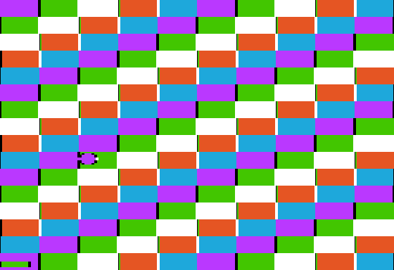

# Disks

Disk images, the emulated Disk II card, disks that boot a Tisple program on
their own, and tables the program reads from its disk while it runs (Disk tables).
Roadmap section 1, "Accurate and instant".

## Commands

```sh
tisple build main.tsp --disk game.dsk [--origin A] [-o game.bin] [--asm]   # every segment
tisple run main.tsp --disk [game.dsk] [machine flags]   # build, then boot the disk
tisple check main.tsp --disk [--origin A]               # laid out as the disk build
tisple disk boot game.dsk game.bin [--origin A]         # any raw binary
tisple machine --disk a.dsk [--disk2 b.dsk] [--write-back]
tisple machine --disk a.dsk --rom Apple2e.rom [--disk-rom DISK2.rom]
tisple disk new|list|put|get|delete IMAGE ...           # DOS 3.3 files
```

- The disk build and run take the code flags of a plain build too: `-O0`,
  `-O1`, `--opt-bisect N`, `--no-pass NAME`, `--no-inline module.fn`. A program
  that does not fit is built with a tighter size budget and says what it traded
  (docs/design.md, Room), so `--no-inline` is not needed to make room.
- Images: `.dsk`/`.do` (DOS 3.3 sector order), `.po` (ProDOS order), both
  140 KB, and `.nib` (35 tracks of 6656 raw disk bytes). The DOS 3.3 file
  commands work on all three.
- `tisple machine --disk` boots with our boot ROM and no Apple ROM. With
  `--rom`, Apple's autostart finds the card in slot 6 and boots it, with our
  boot ROM or with `--disk-rom DISK2.rom`.
- `--save-snapshot` / `--load-snapshot` include the card and both disks:
  boot once, snapshot, restore. With `--load-snapshot`, the disks come from
  the snapshot and `--disk` only names the files `--write-back` writes.
- `--write-back` saves written disks to their files at the end, in the
  file's own format. A sector image is not saved if a track no longer reads
  as 16 good sectors (the error names the track and sector).

## The self-booting disk

- Track 0, physical sectors 0-2: our loader (`src/disk/boot_loader.cpp`,
  original, MIT under the runtime exception). Its first byte is 3, so the boot
  ROM loads the three sectors to `$0800-$0AFF` and jumps to `$0801` (Apple's
  ROM reads sectors while their number is below that byte, as ours does).
- Tracks 1 on: the program's segments (docs/language.md, Memory map), each from
  the page holding its start and from a track of its own, 16 pages a track,
  track 17 skipped. The loader's table gives each one's first page, pages and
  memory: main memory, the language card's bank 2 (switched in for writes, two
  reads of `$C083`), its bank 1 (`$D000-$DFFF`, two reads of `$C08B`), or aux memory (each sector read to the first page of a main
  segment, then copied over with RAMWRT on; the aux segments load first, so that
  page is loaded again after them). The loader writes whole pages, so segments of
  one memory that share a page are one on the disk, with zeros between them
  (2026-10-30: two reserved rows of text page 2 split page `$0B` in three, and
  each load cleared the others' bytes there); segments whose bytes overlap are an
  error. Aux memory's pieces less than 4 pages apart, from `$0800` up, are one
  segment already (2026-10-31, docs/language.md, Memory map). The rest of the disk
  is an empty DOS 3.3 volume with the program's tracks marked in use, so `tisple disk put` can add files, and
  its catalog on track 17 survives a program of any size.
- Size limits (2026-10-29; the table for every build is in docs/language.md,
  Memory map). Main memory `$0B00-$BFFF`: the loader runs in `$0800-$0AFF`, so
  the compile limit for `--disk` builds is `$C000` and the memory below the
  origin starts at `$0B00`. With the zero-page save buffer at `$BF00`, code and
  data get `$0B00-$BEFF`, 45 KB, less any screen the program keeps with
  `:reserve` (8 KB a hi-res page). The language card adds 12 KB at
  `$D000-$FFFF`, aux memory 46 KB at `$0800-$BFFF`: about 103 KB in all. A disk
  holds 528 pages (tracks 1-34 but 17), at most 10 segments, each rounded up to
  whole tracks. A one-stretch program from `$6000` still has 24 KB, as before.
  Plain builds for DOS (`tisple build -o`) are one file, code and data in
  `$6000-$94FF` from the default origin (the save buffer at `$9500`);
  `tisple run` without `--disk` lays out like them but loads every segment, so
  there it is `$0800-$94FF`, the language card and aux memory.
- The loader takes nothing from the boot ROM but the load of its three sectors
  and X = slot * 16. It turns the motor on, steps (2.5 ms per half-track each
  way, 25 ms settle) and reads with its own code, reading whichever wanted
  sector passes the head next: about two turns a track, 0.75 s for a one-track
  program in the emulator; an aux track can take three, since the copy can
  miss the next sector. programs/text_demo, 20 tracks, shows its first page
  10.5 s after power on with our ROM, 12.2 s through Apple's (2026-10-29).
- The screen while it loads: text page 1 in 40 columns, cleared to spaces but
  for LOADING in row 12 (the screen holes, the last 8 bytes of each 128, are the
  cards' and stay as they were). Nothing loads there, so it stays so until the
  program shows something else. Before (version 2), aux sectors went through
  `$0400-$04FF` and showed as rows of garbage for the whole load.
- At the jump: stack `$FF` (then the JSR), A = X = Y = 0, interrupts off,
  decimal off, 80STORE off, RAMRD and RAMWRT off, language card `$C082` (as a
  direct load), motor off, text page 1 shown. It also used `$0296-$0365` and
  zero page `$DB-$EF`. A program in the language card
  switches its RAM in itself, in the startup.
- If the program returns, the loader switches to text and enters the monitor
  (`$FF69`). The emulator stops there instead ("returned from the entry
  point"), like a direct load. A signature at `$0AF0` ("TISPLE BOOT", version
  3, the return address) lets the machine find that address; version 2 disks,
  and version 1 ones (two sectors with it at `$09F0`), are still found.

## Disk tables

Data the program reads from its own disk while it runs (2026-10-30, for Catwiz's art a fight
at a time): a const table placed `:on disk` lives on the boot disk, not in memory, and
`lib/disk` reads it into main or aux memory, calling a function of the program's between
sectors.

```scheme
(import disk)
(import tables)
(import unpack)

(tables.packed_bytes FOREST (...) :on disk)              ; packed, for lib/unpack
(const MAP (array u8 2048) (make ...) :on disk :interleave 1)
(let art (array u8 8192) :address 0x6000 :in aux :reserve)
(let map (array u8 2048))

(fn animate () void ...)                                 ; between two sectors

(fn fight () void
    (disk.read_with (as (ptr u8) 0x6000) (addr_of (at FOREST 0)) disk.AUX animate)
    (unpack.aux_to_main (as (ptr u8) 0x2000) (as (ptr u8) 0x6000))
    (disk.read (addr_of (at map 0)) (addr_of (at MAP 0)) disk.MAIN))
```

```sh
tisple run examples/disk_stream.tsp --disk     # four pictures read while a ball bounces
```

<p>


</p>

| Call | Does |
| --- | --- |
| `(disk.read dst table bank)` | the table's bytes to `dst` in `disk.MAIN` or `disk.AUX` memory; gives `disk.DONE` (0) or an error |
| `(disk.read_with dst table bank step)` | the same, calling `step`, a `(fn () void)`, after each sector but the last |

`table` is `(addr_of (at NAME 0))`. Exactly the table's bytes are written: the last sector,
when part full, goes through the reader's own page. The errors: `disk.NO_CARD` (no Disk II
card's rom in the slot the disk booted from, or no reader: a build without `--disk`),
`disk.NO_DISK` (three turns' worth of disk bytes without an address field, on the track and
again after stepping out to track 0), `disk.BAD_SECTOR` (64 address fields, four turns,
without a wanted sector reading), `disk.BAD_TRACK` (five seeks that land on another track).
The motor is off after every result. Nothing waits without a bound but the read loops inside
a data field, which wait for each disk byte: a drive that gives none at all would hang them;
an empty drive gives noise, which ends in `NO_DISK` (2.1 s from the start of the read).

- **What `:on disk` takes.** A const `(array u8 n)`, 1 to 49152 bytes, with no addresses in
  it and no `:address`, `:align` or `:boundary`. `tables.packed`, `tables.packed_bytes` and
  `tables.table` pass the option on. The name then holds the table's record, 3 bytes and one
  a sector, as const data: the length, the first track, and for each sector its track less
  the first (high four bits) and its physical sector. Code names it only inside an
  `addr_of`; `(at MAP 3)` is an error that says to read it with lib/disk. A record no code
  names is not in the binary, as for any const.
- **Where they go.** In declaration order on the last tracks, as high as they fit: track 34
  down, the catalog's track 17 skipped. So the places are known while checking, before the
  program's size is, and the program's own growth never moves them. Tables share tracks; a
  table's sectors go `:interleave` physical sectors apart (1-15, 2 by default), the next free
  one when that is taken, from the sector after the table before. `tisple build --disk` says
  which tracks they take, marks them used in the DOS volume, and fails if the program's
  tracks reach them. Other builds hold no tables and warn that `disk.read` gives `NO_CARD`.
- **The reader.** Our own 6502 code (src/disk/disk_reader.cpp, reader_read.cpp; MIT as well,
  like the loader), 1,219 bytes at `$1700`, with its bounce page and tables in
  `$1400`-`$16FF`. lib/disk keeps `$1400`-`$1BFF` with two `:reserve` lets (`disk.work`,
  `disk.reader`), and the disk build puts the reader on the disk as one more segment, so it
  costs the program no bytes of its own; the loader writes the slot it booted from into it
  (`$1706`; 0 would mean slot 6). It reads its arguments from lib/auxmem's `from` and `to`
  when a read starts and uses no other zero page.
- **How it reads.** Motor on, drive 1; the head found from the first address field it reads
  (or by stepping out to track 0), then each track's sectors: seek (the loader's step
  timing), then whichever wanted sector comes under the head next. The read loops are the
  loader's, at most 22 cycles a disk byte, with nibble tables that give each value already
  shifted into place (the high six bits times 4, the low pairs swapped; xor keeps both
  through the chain), so one pass of about 4,300 cycles puts the sector together at its
  place, in aux memory with RAMWRT on. That pass is longer than the gap to the next sector,
  so every layout reads every other sector a turn: two turns a track.

### Speed and the time between sectors

Measured on the built-in IIe (tests/test_disk_read_timing.cpp, 2026-10-30): an 8 KB table
(two tracks, a seek between), read with a step that waits n cycles, seconds:

| step's wait | 1:1 | 2:1 | 3:1 |
| ---: | ---: | ---: | ---: |
| 0 to 8,750 | 0.90 | 0.90 | 0.90 |
| 9,000 to 21,000 | 1.24-1.27 | 1.24-1.27 | 1.24-1.27 |
| 22,000 to 30,000 | 1.69-1.73 | 1.69-1.73 | 1.69-1.73 |

- 8.9 KB a second, at any interleave. A step has about 8,700 cycles a sector (8,750 of wait
  measured, its call included) before the read slows: half a frame. Past that each gap
  costs a sector's time more, a turn more a track: 6.4 KB a second up to about 21,000
  cycles, 4.7 from 22,000 to 30,000 (each tier a sector, 12,656 cycles, wider). The step is called every 25,312 cycles (two sectors) while it
  keeps within the gap.
- The interleave changes the order the sectors come in, not the speed. At 2:1 they come in
  order (from wherever the head lands on the track, round to it), so a step can use what has
  come; at 1:1 every other one, then the rest.
- The budget is the gap between the end of one data field and the address field two
  sectors on (about 13,400 cycles at 300 rpm), less the pass that puts the sector together
  and the calls. A drive turning slower or faster than 300 rpm moves it a little.

### Interrupts

Decided 2026-10-30: they keep running. The reader turns them off (SEI) from an address
field's first mark to the end of its data field, about 11,900 cycles, and while it puts a
sector into aux memory with RAMWRT on (about 4,300), and gives the caller's I flag back
between and while it waits for the next sector, seeks and steps. A tick that comes while
they are off waits; one tick can wait, so none is lost while the ticks are more than about
12,000 cycles apart (85 a second). With lib/mockingboard's 60 a second, 98 ticks through a
12 KB read were all taken, the latest 11,695 cycles (11 ms) late
(tests/test_disk_read_timing.cpp): notes start up to 11 ms late while a sector is read. The
reader needs no `(auxmem.guard)`: it never has RAMWRT on with interrupts on.

### The step function

- A `(fn () void)` of the program's; frames are safe, since the call is a plain pointer call
  in lib/disk's loop.
- It must not call `disk.read` itself. lib/unpack, lib/dhgr and lib/auxmem are fine: lib/unpack
  and dhgr.runs borrow `$F2`-`$FE`, which the reader reads only when a read starts.
- Its writes to main memory go where the program's always do; with 80STORE on, keep `dst`
  clear of the screens (lib/dhgr keeps it off).

### Tests

- tests/test_disk_read.cpp: tables of 1, 255, 256, 257, 1000, 4096, 4097, 6000 and 9000 bytes
  at 1:1, 2:1 and 3:1 read into main and aux memory byte for byte, the byte after each
  untouched; a packed table read into aux memory and unpacked; the places on the disk; the
  checker's errors.
- tests/test_disk_read_fail.cpp: no reader, no card in the slot, no disk, a sector whose data
  field never checks, a track whose address fields name another, and a head that is not
  where the reader thinks (it reads on).
- tests/test_disk_read_timing.cpp: the table above, the step's calls counted and timed, and
  the Mockingboard's ticks through a read into aux memory.
- tests/test_disk_stream.cpp: examples/disk_stream booted, ten reads begun, each finding the
  picture before it on the page shown, but for the ball.
- On a real machine: not yet. The budgets allow for a drive still coming up to speed after
  the motor goes on (three turns for an address field); the step timing is the loader's.

## Our boot ROM

`src/machine/disk2_rom.cpp`, used when no `DISK2.rom` is given. It is built
for the slot it sits in, uses no monitor routines and waits for nothing, so it
is only for the emulator. What a disk sees:

- `$Cn00`: cold boot. Motor on, drive 1, read mode; walks the head down 80
  half-tracks to track 0; reads physical sectors 0, 1, ... of track 0 to
  `$0800`, `$0900`, ... while the next sector number is below the byte at
  `$0800`; then `JMP $0801` with X = slot * 16.
- `$Cn5C`: read one more sector of the current track. In: `$26/$27` buffer,
  `$3D` physical sector, `$41` the track (compared with the address field),
  X = slot * 16 (not needed by ours). It reads, adds 1 to `$27` and `$3D`,
  reads again while `$3D` is below `($0800)`, else `JMP $0801` with X = slot *
  16. DOS 3.3's first boot sector uses this through `JMP ($003E)`.
- Zero page on entry to `$0801`: `$2B` = slot * 16, `$26` = 0, `$27` = the
  page after the last one read, `$3D` = the next sector, `$41` = 0, `$40` =
  the track found; `$3C` scratch; `$3E/$3F` never touched. A = `$3D`, Y = 0.
- `$0300-$0355` scratch; the nibble table at `$02D6 + n` (`$0356-$03D5`), as
  Apple's ROM leaves it.
- Signature: `$Cn01` = `$20`, `$Cn03` = `$00`, `$Cn05` = `$03`, `$Cn07` =
  `$3C` (the autostart ROM's test), `$CnFF` = `$00` (16 sectors, for ProDOS).

## The emulated card

`src/machine/disk2.cpp`, adapted from AppleWin (see
`third_party/applewin/README.md`). Tracks are loops of bit cells, 4 cycles
each: a disk byte takes 32 cycles, a self-sync byte 40, a track from a `.dsk`
51264 cells (205056 cycles, about 300 rpm). Every access catches the disk up
to the cycle, so copy protection that counts bits or reads half-finished bytes
sees what it would on a drive. Approximations are listed in
`src/machine/apple2.hpp`.

### The drives' sound

The window, `--wav` and the phone player play what a Disk II sounds like,
made up from the card's own events (`src/machine/drive_audio.cpp`; nothing
recorded). The card logs each head step, each new pull against a stop (a
magnet change that asks the head past track 0 or 39.5), and each change of
the motor or the selected drive, with its cycle:

- a step is a tick: a bank of seven damped resonators struck in its upper
  modes, plus a short click of noise. A seek is a run of them.
- a pull against the stop is a knock: the same bank struck hard and low, a
  longer click, and one bounce 3 ms later. The boot's recalibration (80 phases
  outward: at the stop, each four phases are a knock, nothing, a step in and a
  step back) is the grind.
- while the drive spins: band-passed noise that swells once a turn (300 rpm,
  5 Hz), a soft 80 Hz thump each turn, the motor's hum, some flutter. It ramps
  up at motor on and runs down over 0.4 s once the drive stops (after the
  card's one-second off delay).

The head keeps a mechanical pace: no impact sooner than 2.5 ms after a step or
36 ms after a knock, and once behind, one per 19.7 ms (Apple's ROM's phase
time), at most 2 s behind. Stepping at a real drive's pace (Apple's ROM, DOS
3.3, our loader) sounds at its cycle. Our boot ROM steps all 80 phases in
2 ms, so its grind plays over the next 1.5 s as Apple's would, and the
loader's first steps sound that much late. Levels: knocks peak at 0.1-0.2 of
full scale, ticks 0.04-0.1, the motor about -41 dBFS; the speaker's square is
0.35. `--no-drive-sound` leaves it out; F3 toggles it in the window; on the
phone it is the `disk` button. Headless runs without `--wav` only pay for the
log (a few stores per step).

## Accuracy checks

- `tests/test_disk_boot.cpp` boots a self-booting disk with our ROM, with
  `Apple2e.rom` + our ROM, and with `Apple2e.rom` + `DISK2.rom`; the program's
  screen and memory match a direct load. The Apple ROM checks skip when
  `~/.local/share/tisple/roms/` lacks the files.
- a2audit (Zellyn Hunter, MIT): `scripts/fetch_a2audit.sh` puts
  `audit/audit.dsk` in `tests/data/a2audit/`; the tests then boot it with
  Apple's ROMs. Results (2026-10-27, again 2026-10-29 from a fresh download,
  version 1.07, with the extended 80-column card): "MEMORY:128K", and its
  language card tests (on main and on aux), aux memory tests and soft switch
  tests all succeed. The video tests after its
  prompt are visual: run it in a window and compare by eye.
- `tests/test_disk_segments.cpp` boots segments in every memory past track 17,
  and a compiled program in four regions, which then runs as a direct load
  does, with our ROM and through `Apple2e.rom` + `DISK2.rom`.
- `tests/test_text_demo.cpp` boots programs/text_demo (72 KB in four places)
  the same two ways, pages through every chapter and checks each is shown from
  the memory its status line names, then leaves with ESC.

```sh
tisple machine --disk tests/data/a2audit/audit.dsk \
    --rom ~/.local/share/tisple/roms/Apple2e.rom \
    --disk-rom ~/.local/share/tisple/roms/DISK2.rom --window
```

## Real hardware

Not tried on a real machine yet. To try:

1. `tisple build main.tsp --disk game.dsk`.
2. FloppyEmu: copy `game.dsk` to its SD card, pick it in Disk II (5.25")
   mode, boot (`PR#6`, or power on with it in slot 6). Or ADTPro: send
   `game.dsk` to a real floppy over serial or audio, then boot that floppy.
3. Check: the program runs; returning from `main` lands at the monitor's `*`;
   `tisple disk list game.dsk` still reads the copy back from ADTPro.
4. What only real hardware tests: the loader's step timing (2.5 ms each way per
   half-track, 25 ms settle) on a real drive, and its read loops at a real
   drive's speed (within the usual 32-cycle budget, 22 cycles at most). A
   failure would show as a hang with the drive light on, likely while seeking.
   A slot other than 6 should work too (the loader is patched for the slot).
