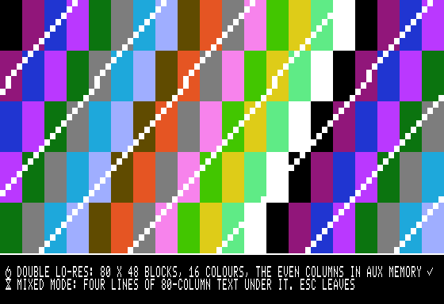
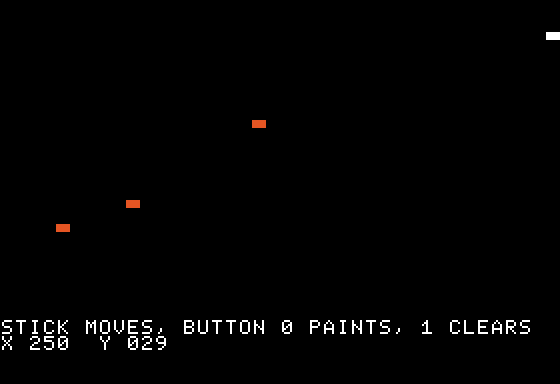

# Hardware libraries

The libraries for the Apple II's own hardware that came out of the survey in
docs/roadmap.md (section 5): the joystick and paddles, what machine a program runs on,
saving to the boot disk (`lib/save`, documented with the other disk code in
[`disks.md`](disks.md), Saves), and the video modes the other libraries left out. The IIe,
enhanced IIe and IIc are the targets; the IIgs is only recognised.

## Joystick and paddles

```scheme
(import joystick)

(fn main () void
    (while true
        (timing.frame)
        (joystick.read)                     ; stick 0: joystick.x, joystick.y, button0/1
        (if (= (joystick.dir joystick.x) -1)
            (move_left))
        (if joystick.button0                ; open-apple on a IIe, fire on a stick
            (fire))))
```

| Call | Does |
| --- | --- |
| `(joystick.read)` | paddles 0 and 1 into `joystick.x` and `joystick.y`, buttons 0 and 1 into `joystick.button0`/`button1` |
| `(joystick.read_pair 2)` | paddles 2 and 3 (a second stick) into `x` and `y`, no buttons |
| `(joystick.paddle n)` | paddle n alone, 0-255, timed like the ROM's `PREAD` (Applesoft's `PDL`) |
| `(joystick.button n)` | button n (0-2) is down; `joystick.OPEN_APPLE` is 0, `CLOSED_APPLE` 1 |
| `(joystick.dir v)` | -1 below `joystick.LOW` (80), 1 above `HIGH` (176), else 0: a stick as four directions |

- Values are PREAD's: 0 at the top or left, about 127 at the centre, 255 at the bottom or
  right; an unplugged paddle reads 255. Real joysticks differ (trim, worn pots), which is
  why `dir`'s dead zone is wide.
- What a read costs. The paddle timers run 2,816 cycles at full scale, about 11 a step, and
  a read waits for them: `read` takes the longer of its two axes' times (2,816 cycles more
  at 255 than at 0, a sixth of a frame), not their sum. Once a frame is cheap; twice is fine.
  A stick held up-left costs almost nothing.
- How. Our own 6502 code (in `lib/joystick.tsp`, a `let` it runs in place: no fixed
  address): one trigger of the four timers, then one loop that reads both paddles at the
  same place in each 17-cycle pass and counts while both run, then the one still running
  alone at the same pace. The count is scaled to PREAD's 11-cycle steps by a table. Against
  the emulator's timers the result is within 1 of the value set, for every value on either
  axis (tests/test_joystick.cpp).
- `read`, not two `paddle` calls. A paddle's timer that is still running when the next
  read starts them again is not restarted on a real machine, so a second `PREAD` straight
  after a first reads its paddle short (Apple's IIe Technical Note #6). `read` starts the
  timers once. The emulator restarts them on every trigger, as AppleWin and MAME do, so it
  would not show that mistake.
- Interrupts are off while the timers are counted (SEI, then the caller's flags back):
  a Mockingboard tick can come up to 3 ms late.
- The buttons are plain reads of `$C061`-`$C063`; on a IIe and IIc buttons 0 and 1 are also
  the open-apple and closed-apple keys.

### In the emulator

- `--joystick "C:X,Y,B;..."`: from cycle C (or `30f`, frames) paddles 0 and 1 read X and Y
  and the buttons are down by B's bits (1 button 0, 2 button 1, 4 button 2). Headless runs
  and tests script the stick this way.
- The window: a game controller's left stick is paddles 0 and 1, its south face button (A)
  button 0, east (B) button 1, west and north button 2 (src/machine/sdl_gamepad.cpp). The
  left and right Alt keys are buttons 0 and 1, as before.

## What machine this is

```scheme
(import machine)

(fn main () void
    (machine.detect)
    (if (not machine.aux)
        (say_needs_128k))
    (if (!= (machine.find machine.MOCKINGBOARD) 0)
        (music_on)))
```

`(machine.detect)` once, then:

| Name | Holds |
| --- | --- |
| `machine.model` | `machine.II`, `II_PLUS`, `IIE`, `IIE_ENHANCED`, `IIC`, `IIC_PLUS`, `IIGS` (a IIgs runs us as an enhanced IIe), `UNKNOWN` |
| `machine.kb` | 48, 64 or 128: main and aux memory together (a II or II+'s language card is not looked for) |
| `machine.aux` | 128K: aux memory, double res and 80 columns |
| `machine.col80` | 80-column hardware, with or without aux memory (a IIe's 1K card has it without) |
| `machine.cmos` | a 65C02 (enhanced IIe, IIc) or the IIgs's 65816; false for the NMOS 6502 |
| `machine.mousetext` | the alternate character set has MouseText: enhanced IIe, IIc, IIgs |
| `(machine.card n)` | slot n's card: `NONE`, `DISK2`, `STORAGE` (a ProDOS block device: hard disk, CFFA3000, MicroDrive, a SmartPort), `MOUSE`, `MOCKINGBOARD`, `SERIAL`, `COL80` (slot 3 on a IIe or IIc), `OTHER` (Pascal 1.1 firmware of another kind) |
| `(machine.find kind)` | the first slot with that card, 0 for none |

How it finds out, from Apple's Miscellaneous Technical Notes #7 and #2:

- The model: the ROM's identification bytes at `$FBB3`, `$FBC0` and `$FBBF`, and `SEC` /
  `JSR $FE1F`, which leaves the carry set on everything but a IIgs.
- The CPU: `99 + 1` in decimal mode. The NMOS 6502 sets N from the binary `$9A`, the 65C02
  from the decimal `$00`.
- Memory, on a IIe: the 80-column card's text page through 80STORE and PAGE2 (two patterns
  written and read back), then aux memory's `$0800` and `$0C00` through RAMRD and RAMWRT,
  which the 1K card answers as one byte. Every byte it writes is put back. The IIc and IIgs
  always have 128K.
- The slots, by their ROMs: `$20 $00 $03` at `$Cn01`/`$Cn03`/`$Cn05` is something that boots
  (a Disk II with `$3C` at `$Cn07`, otherwise a ProDOS block device); `$38 $18` at
  `$Cn05`/`$Cn07` and `$01` at `$Cn0B` is Pascal 1.1 firmware, whose kind is at `$Cn0C`
  (`$20` mouse, `$3x` serial, `$88` 80 columns). The Mockingboard has no ROM: its 6522's
  timer is watched counting (as lib/mockingboard finds it). `$CFFF` is read after each slot,
  so no card's `$C800` ROM stays on.

The ROM bytes need the ROM switched in, and RAMRD switches the memory code runs from, so
those two tests are our own 6502 code (in `lib/machine.tsp`) copied to `$0100` and run there:
the bottom of the stack page, which neither the language card nor RAMRD switches. It takes up
to `$0189`; the stack stays above it unless calls nest some 50 deep. Interrupts are off
while it runs. Afterwards the language card is as it was: on a IIe or IIc by its status reads
(its RAM and bank, with writes on, as Tisple's startup leaves it), on a II or II+ (no status
reads) its bank 2 RAM if `$D000`-`$D007` read other than the ROM there. So `detect` may run
from the language card (tested in both banks; a function with a `jsr` never goes to bank 1, so
from there it is reached through a stub).

`examples/machine_info.tsp` shows the answers on the text screen.

### In the emulator

The built-in machine has no ROM of Apple's, so it answers the identification bytes itself:
`--model iie-enhanced` (the default, since its alternate character set has MouseText),
`iie`, `iic`, `iiplus` or `iigs` (whose `$FE1F` clears the carry). Only those bytes change;
the hardware stays an NMOS IIe, so `machine.cmos` is false on all of them. `--64k` takes the
extended 80-column card out: aux memory reads as the floating bus and writes go nowhere.
With `--rom`, Apple's ROM answers (tests/test_machine_lib.cpp runs Apple2e.rom,
Apple2e_Enhanced.rom and Apple2_Plus.rom when the owner's copies are there).

Not covered: the IIc's and IIgs's vertical blank, which `lib/timing` reads the IIe's way;
a II or II+'s 16K language card; the IIe card for the Macintosh LC (it answers as an
enhanced IIe).

## Mixed modes, double lo-res and MouseText

<p>


</p>

*examples/dlores_demo.tsp and examples/stick_paint.tsp.*

### Graphics over four lines of text

The Apple's mixed mode shows the bottom 32 lines as text rows 20-23 of the text page that goes
with the graphics page shown. Each graphics library has it now, and the text libraries keep to
those rows:

| Call | Shows |
| --- | --- |
| `(lores.mixed)` | lo-res 40 x 40 over four 40-column lines; `lores.clear` then leaves the text rows |
| `(hgr.mixed)` | hi-res 280 x 160 over four 40-column lines |
| `(dlores.on true)` | double lo-res 80 x 40 over four 80-column lines |
| `(dhgr.on true)` | double hi-res 140 x 160 over four 80-column lines (lib/dhgr, as before) |
| `(text40.window 20)`, `(text80.window 20)` | the text from row 20 down only: `clear`, the cursor's home and scrolling keep to rows 20-23; `(window 0)` is the whole screen again |

```scheme
(lores.mixed)
(lores.clear)
(text40.window 20)
(text40.clear)                  ; rows 20-23 only
(text40.print "SCORE")          ; past row 23 the four lines scroll, the picture stays
```

`text40.poke` and `text80.poke` put one screen code at a place without moving the cursor.

### Double lo-res

`lib/dlores`: 80 x 48 blocks in the 16 lo-res colours (`dlores.BLACK` to `WHITE`), the even
block columns from aux memory, on a 128K IIe (Rev B board), IIc or IIgs; `machine.aux` says.

| Call | Does |
| --- | --- |
| `(dlores.on mixed)` | 80VID, 80STORE, graphics, lo-res, AN3 off (double res); with `true` the four text lines |
| `(dlores.plot x y colour)`, `(dlores.get x y)` | one block, x 0-79, y 0-47 |
| `(dlores.clear colour)` | every block (not the text rows when mixed) |
| `(dlores.off)` | back to 40-column text |

- Memory: text page 1 in both memories. Block x is in aux memory when x is even, at row
  `y / 2`'s byte `x / 2`, the low nibble for even y, as lo-res.
- The hardware shows an aux nibble rotated right one bit, so `plot` stores aux colours
  rotated left and `get` turns them back; tests/test_video_modes.cpp checks that every colour
  shows the same in both columns and as the plain lo-res screen shows it.
- Aux memory is reached the way lib/text80 reaches it: 80STORE on, PAGE2 picking aux memory
  for `$0400`-`$07FF`, through `io_read` and `io_write` so nothing moves across the switch.
  So lib/text80's calls work on the mixed window's text with no switching between the two.
  A plot costs about 100 cycles; a whole screen takes 5 frames (the demo redraws every block
  each pass).

### MouseText

`lib/mousetext`: the 32 pictures at screen codes `$40`-`$5F` of the alternate character set,
on an enhanced IIe, a IIc and a IIgs (`machine.mousetext`; an unenhanced IIe shows inverse
capitals there).

- Names for all 32: `mousetext.CLOSED_APPLE`, `OPEN_APPLE`, `POINTER`, `HOURGLASS`, `CHECK`,
  `CHECK_INVERSE`, `RUNNER_INVERSE`, `RUNNER`, `LEFT_ARROW`, `ELLIPSIS`, `DOWN_ARROW`,
  `UP_ARROW`, `TOP_BAR`, `RETURN`, `BLOCK`, `SCROLL_LEFT`, `SCROLL_RIGHT`, `SCROLL_DOWN`,
  `SCROLL_UP`, `MIDDLE_BAR`, `CORNER`, `RIGHT_ARROW`, `CHECKER_1`, `CHECKER_2`,
  `FOLDER_LEFT`, `FOLDER_RIGHT`, `RIGHT_BAR`, `DIAMOND`, `TOP_BOTTOM`, `CROSS`, `SQUARE_DOT`,
  `LEFT_BAR`; written with `text80.put_code` or `text40.put_code` (or `poke`).
- `(mousetext.on)` turns the alternate set on in 40 columns (`text80.on` does it already).
- `(mousetext.frame80 col row w h)` and `frame40`: the frame Apple's own MouseText windows
  use, round the w x h text at col, row and outside it: underscores along the row above,
  `RIGHT_BAR` down the column to the left, `LEFT_BAR` down the column to the right, `TOP_BAR`
  along the row below.
- `(mousetext.bar80 row)` and `bar40`: `TOP_BAR` across a row, the line under a menu bar.

The emulator draws its own MouseText (src/machine/font.cpp), whatever `--model` says.
